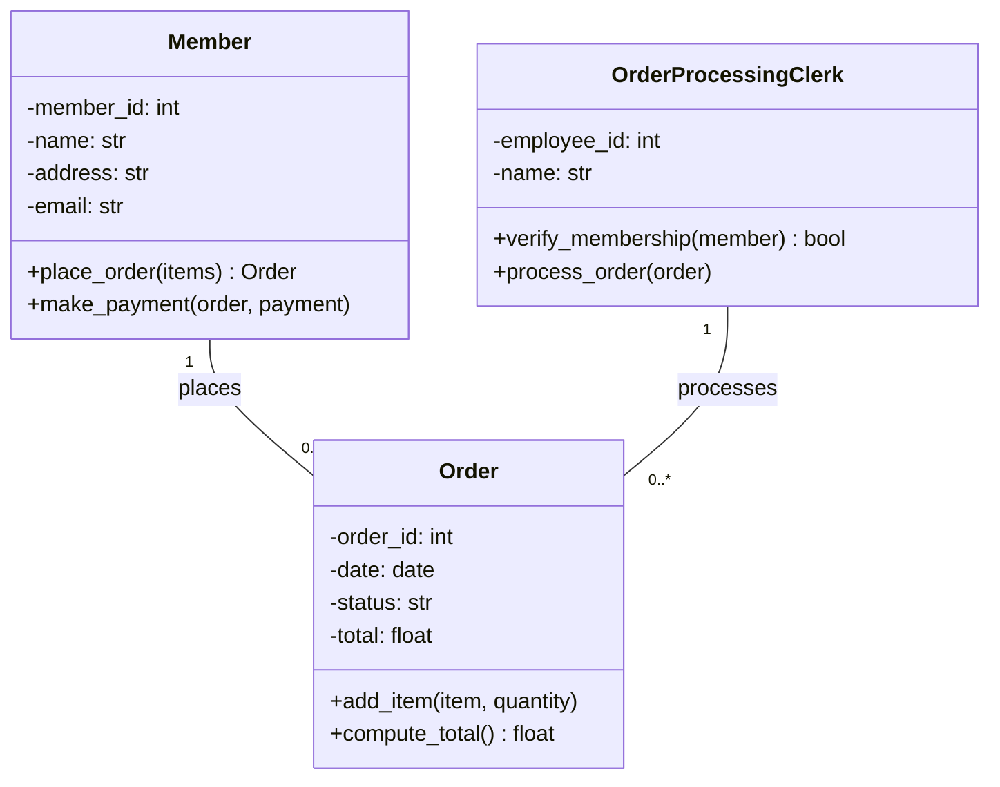
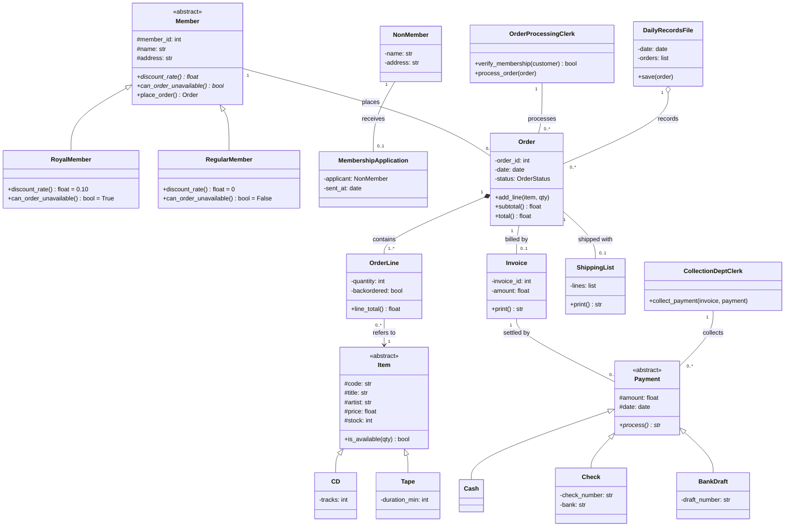
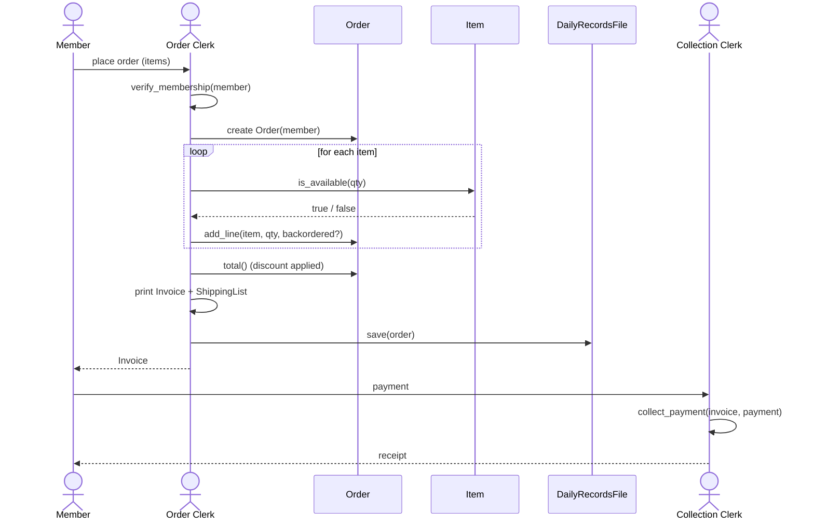
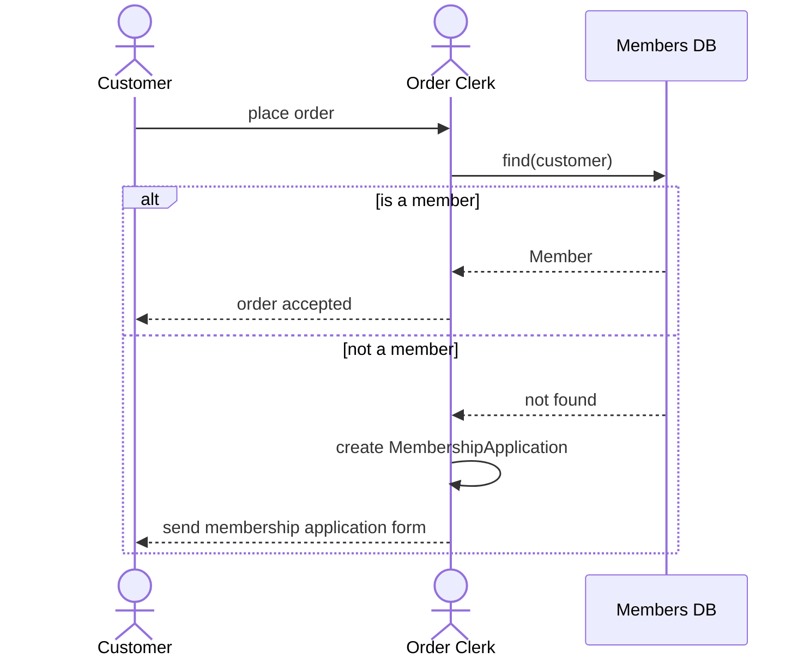
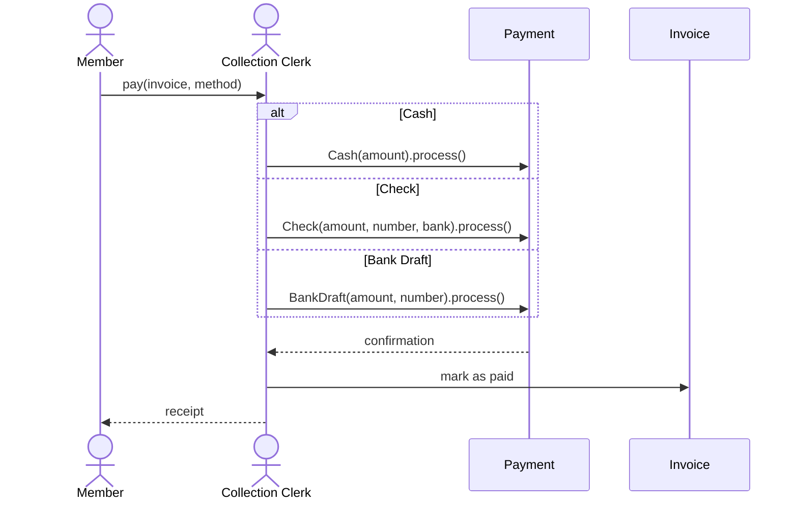
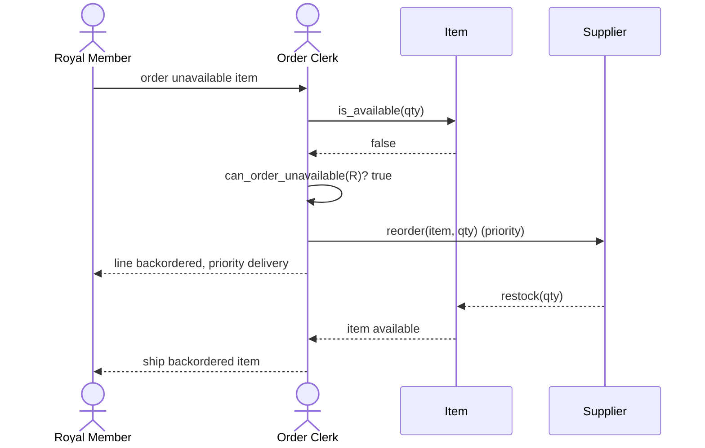

# Exo 2 - ABCD Records 📼

Exercise: https://gist.github.com/bdallard/2d2407c4de4c182afca6d3ec7235e9eb (slide 68). Code: [`abcd_records.py`](abcd_records.py).

> Mermaid doesn't have real use case diagrams, so I used a flowchart: use cases are ovals, the `ABCD Records System` box is the system boundary and the dotted arrows are `<<include>>` / `<<extend>>`.

## Level 1

### Task 1.1 - simple use case diagram

### Task 1.2 - basic class diagram

## Level 2

### Task 2.1 - full use case diagram

- `<<include>>` (always happens): Place Order includes Verify Membership and Verify Item Availability, Process Order includes Print Invoice and Print Shipping List
- `<<extend>>` (only sometimes): Apply Discount and Order Unavailable Items extend Place Order (only for Royal members), Send Membership Application extends Verify Membership (when the customer is not a member)

### Task 2.2 - full class diagram

#### Scenario: a Royal member orders 2 CDs (one unavailable) and pays by check

1. `RoyalMember.place_order()` creates an Order with 2 OrderLines (CD A in stock, CD B out of stock)
2. The clerk checks the membership (ok) and the availability. CD B is not available but Royal members can order it anyway, so the line is `backordered`
3. The 10% Royal discount is applied, the Invoice has the total and the ShippingList only has CD A
4. The collection clerk takes the Check and the order is saved in the DailyRecordsFile

This scenario runs in the `__main__` of `abcd_records.py`.

## Level 3 - sequence diagrams

### 1. Complete order processing

### 2. Membership verification (success and failure)

### 3. Payment processing (all types)

### 4. Item reordering for Royal members

