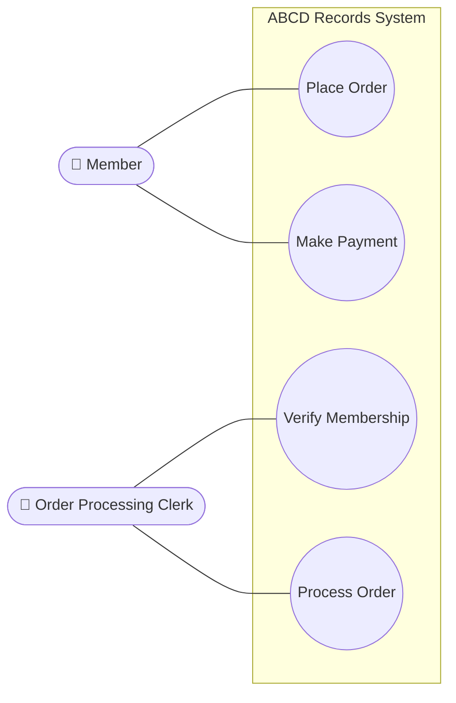
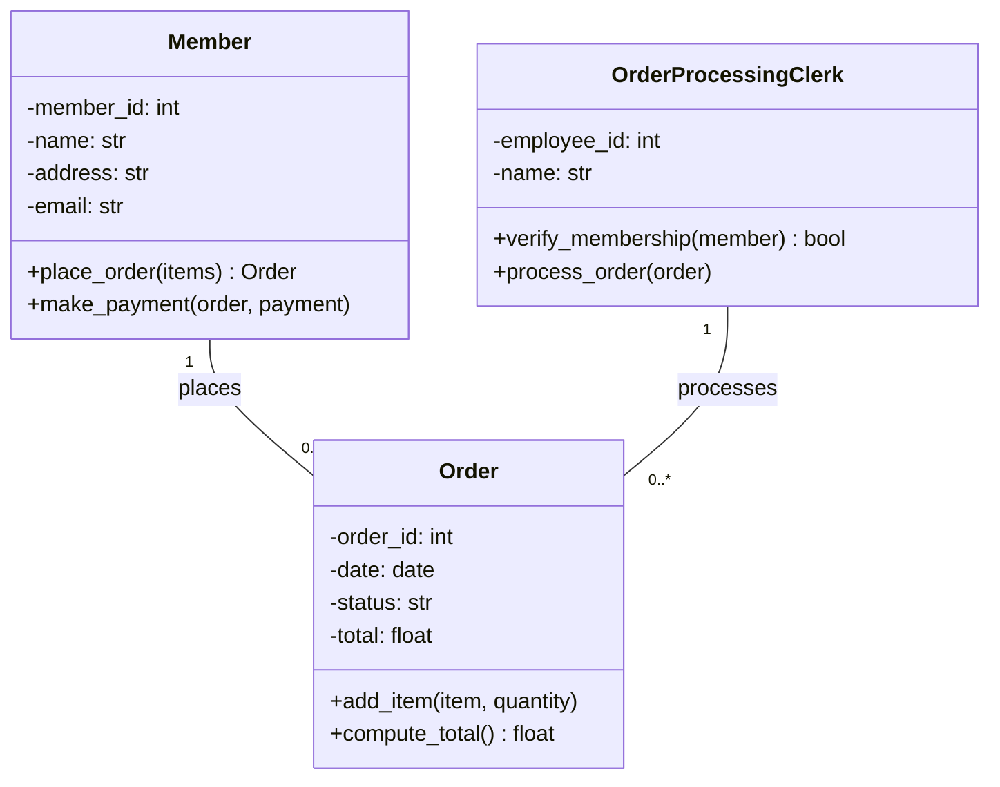
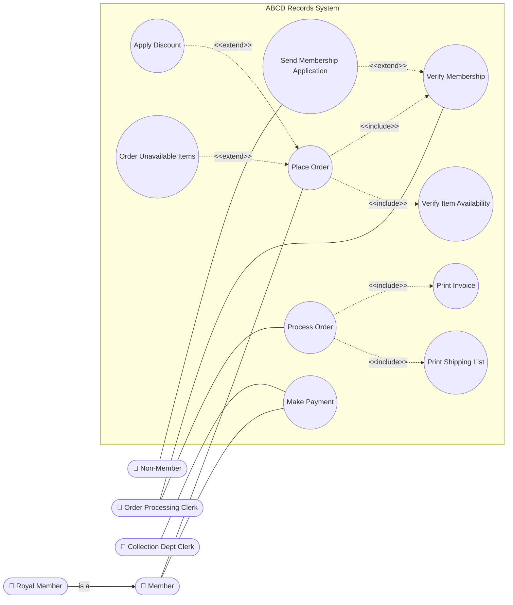
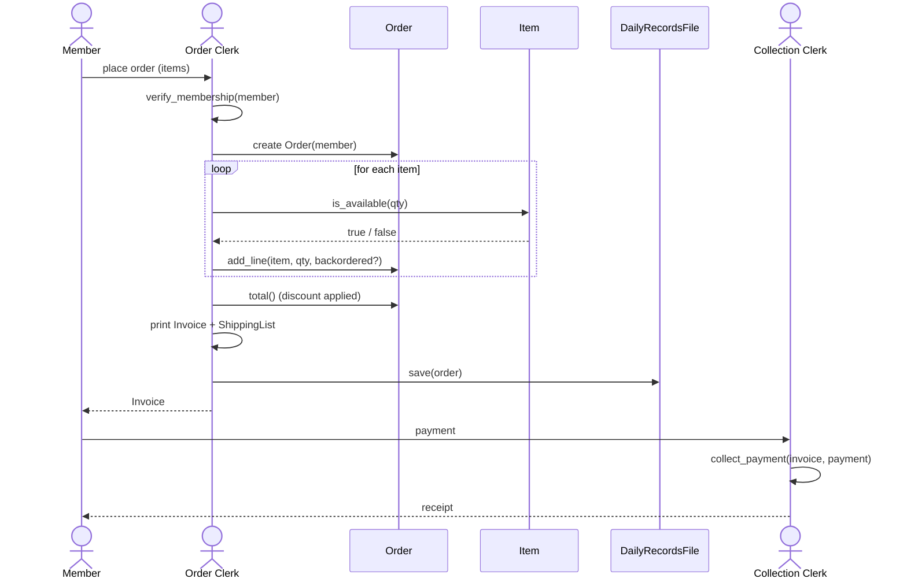
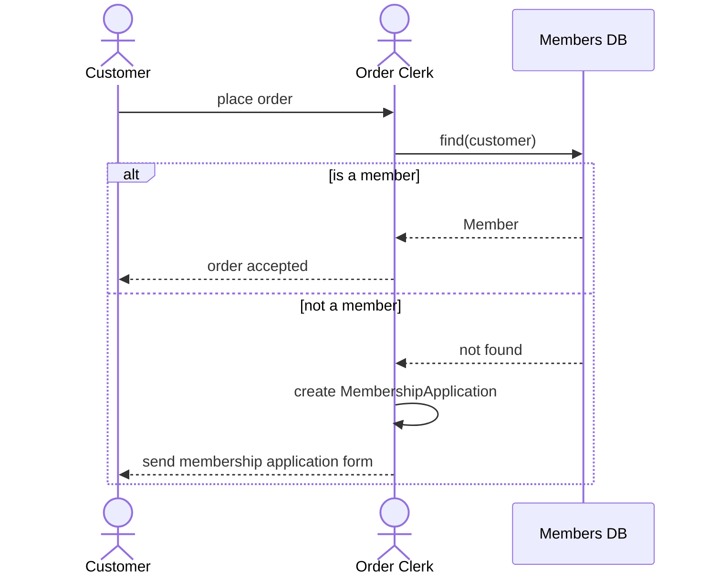
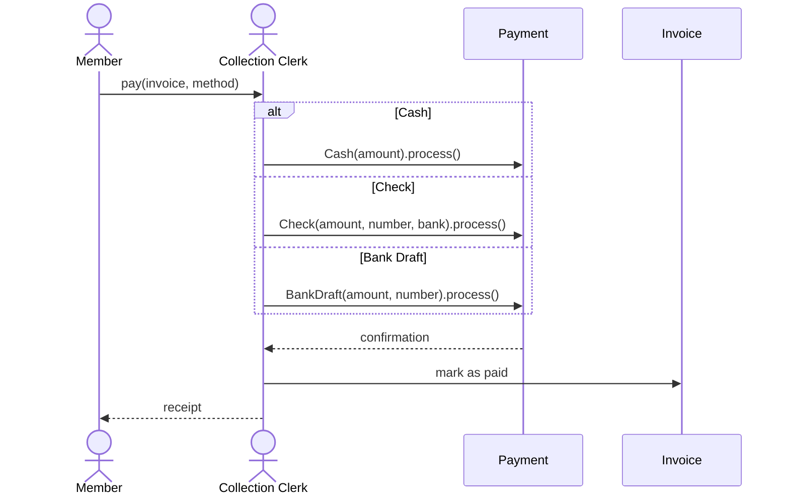
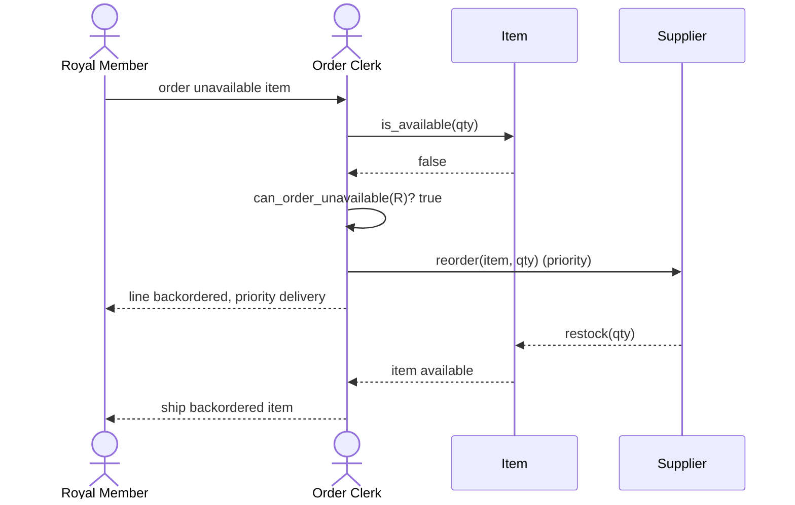

# Exo 2 - ABCD Records 📼

Énoncé : https://gist.github.com/bdallard/2d2407c4de4c182afca6d3ec7235e9eb (slide 68). Implémentation : [`abcd_records.py`](abcd_records.py).

> Mermaid n'a pas de vrai diagramme de cas d'utilisation. Les cas d'utilisation sont donc représentés par des ovales dans un *flowchart*, le rectangle `ABCD Records System` joue le rôle de frontière du système, et les flèches en pointillés sont étiquetées `<<include>>` / `<<extend>>`.

## Level 1

### Task 1.1 : cas d'utilisation simples

### Task 1.2 : classes de base

## Level 2

### Task 2.1 : cas d'utilisation complets

- `<<include>>` (obligatoire, toujours exécuté) : *Place Order* inclut *Verify Membership* et *Verify Item Availability*. *Process Order* inclut *Print Invoice* et *Print Shipping List*.
- `<<extend>>` (optionnel, sous condition) : *Apply Discount* et *Order Unavailable Items* étendent *Place Order*, seulement pour les membres Royal. *Send Membership Application* étend *Verify Membership* quand le client n'est pas membre.

### Task 2.2 : classes complètes

#### Scénario : un membre Royal commande 2 CD (dont un indisponible) et paie par chèque

1. `RoyalMember.place_order()` crée un `Order` avec 2 `OrderLine` (CD A en stock, CD B en rupture).
2. Le clerk vérifie l'adhésion (OK) puis la disponibilité. CD B est indisponible, mais `can_order_unavailable()` renvoie `True`, donc la ligne est marquée `backordered`.
3. La remise Royal de 10 % est appliquée. L'`Invoice` reprend le total, la `ShippingList` ne contient que le CD A.
4. Le `Collection Dept Clerk` encaisse un `Check` et la commande est enregistrée dans le `DailyRecordsFile`.

Ce scénario est exécuté dans `abcd_records.py` (bloc `__main__`).

## Level 3 : diagrammes de séquence

### 1. Traitement complet d'une commande

### 2. Vérification de l'adhésion (succès et échec)

### 3. Paiement (tous types)

### 4. Réapprovisionnement pour les membres Royal

