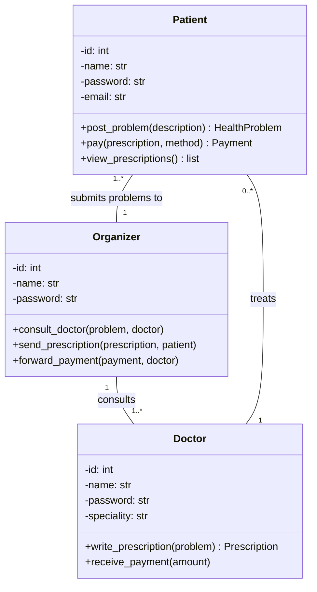
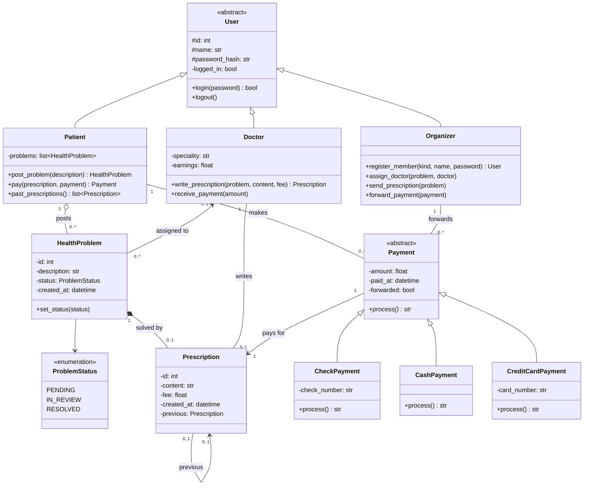
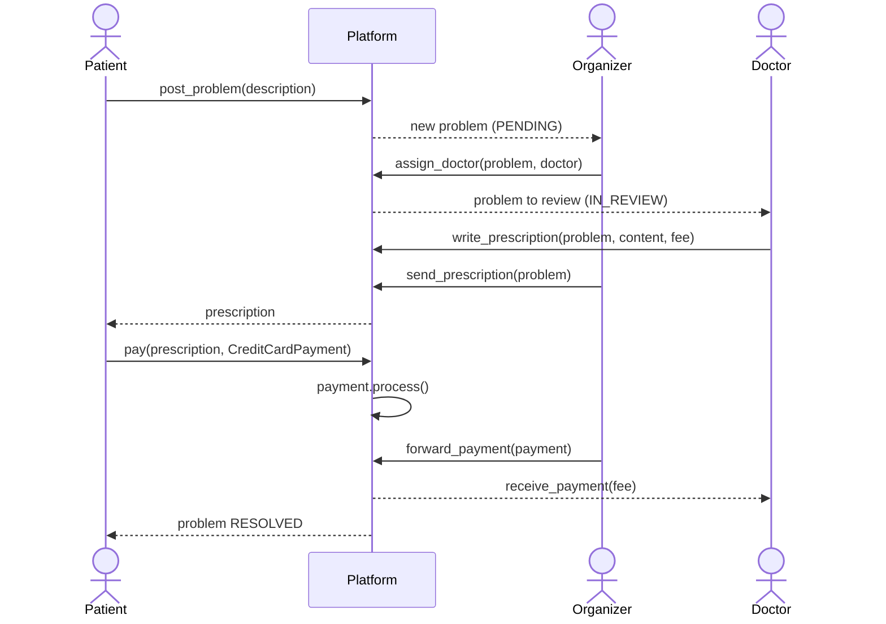
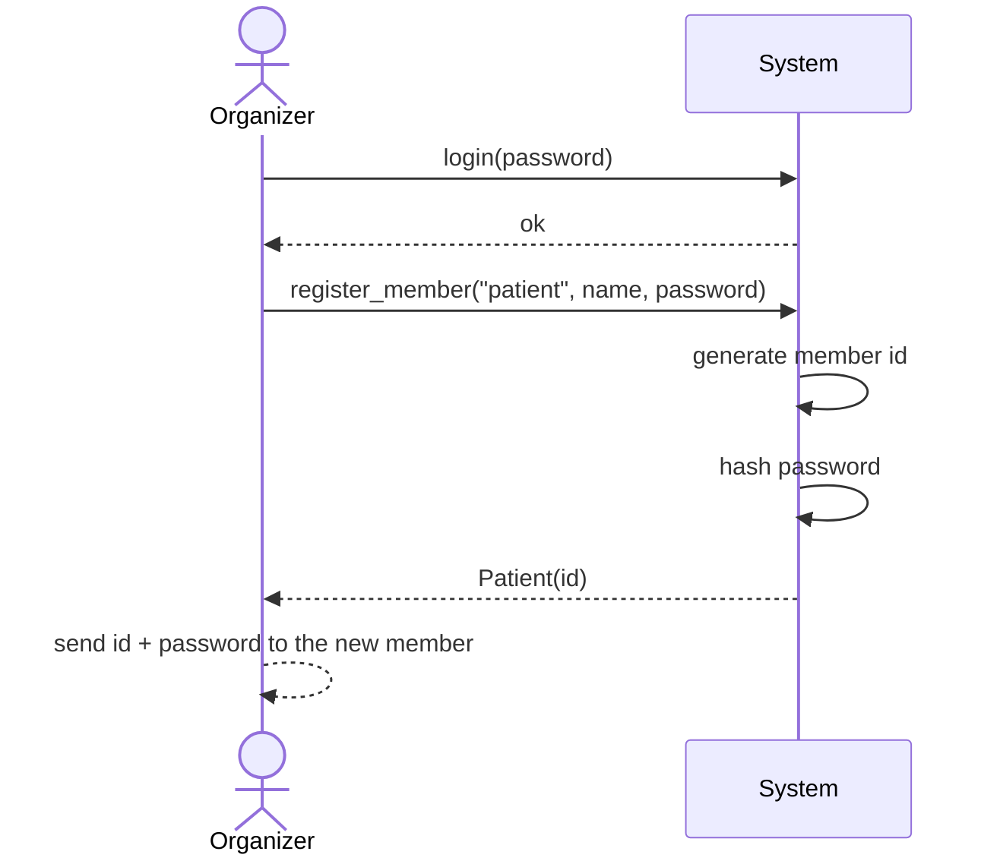
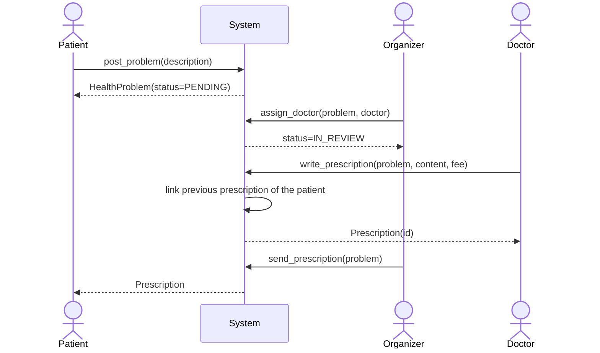
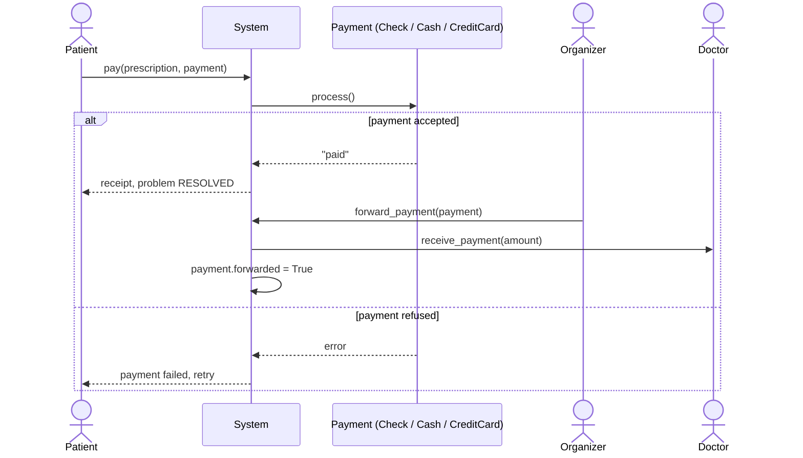

# Exo 1 - Hospital Management System 🏥

Exercise: https://gist.github.com/bdallard/2d2407c4de4c182afca6d3ec7235e9eb (slide 68). Code: [`hospital.py`](hospital.py).

## Task 1 - basic class diagram

## Task 2 + 3 - full class diagram

My choices:
- `User` is an abstract superclass (id, name, password, login/logout), Patient, Doctor and Organizer inherit from it
- `Payment` is abstract and each payment type overrides `process()` (polymorphism, it's the Strategy pattern)
- composition `HealthProblem *-- Prescription`: a prescription doesn't exist without its problem
- aggregation `Patient o-- HealthProblem`: the patient keeps a history of his problems
- `ProblemStatus` is an enum (PENDING, IN_REVIEW, RESOLVED), and I added timestamps

## Task 2 - sequence: a patient submits a problem, gets a prescription and pays

## Task 3 - system sequence diagrams

### 1. Patient registration (organizer creates a new member)

### 2. Consultation flow (problem -> prescription delivered)

### 3. Payment processing (patient pays, organizer forwards to doctor)

## Questions

1. **Patient consulting multiple doctors?** Each HealthProblem is assigned to one doctor, so a patient with several problems can see several doctors. If we want several doctors on the same problem, we could add a `Consultation` class between HealthProblem and Doctor (with `1..*` on the doctor side).
2. **Reusable prescriptions?** A prescription stays linked to its problem but it has a reference to the previous one (`previous`), so we keep the history and a renewal is just a new prescription pointing to the old one. For real reusable ones we could have a `PrescriptionTemplate` class.
3. **Design pattern for the payment?** Strategy: each payment type is a class with its own `process()`. We could also use a Factory to create the right one from "check" / "cash" / "card".
4. **Data integrity for payments?** Use database transactions (payment + forwarding succeed or fail together), check the amount matches the prescription fee, and have a `forwarded` flag so a payment can't be forwarded twice. Keeping a log with timestamps also helps.
