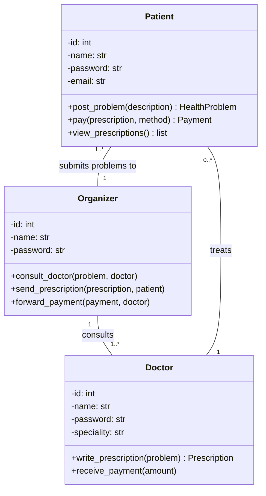
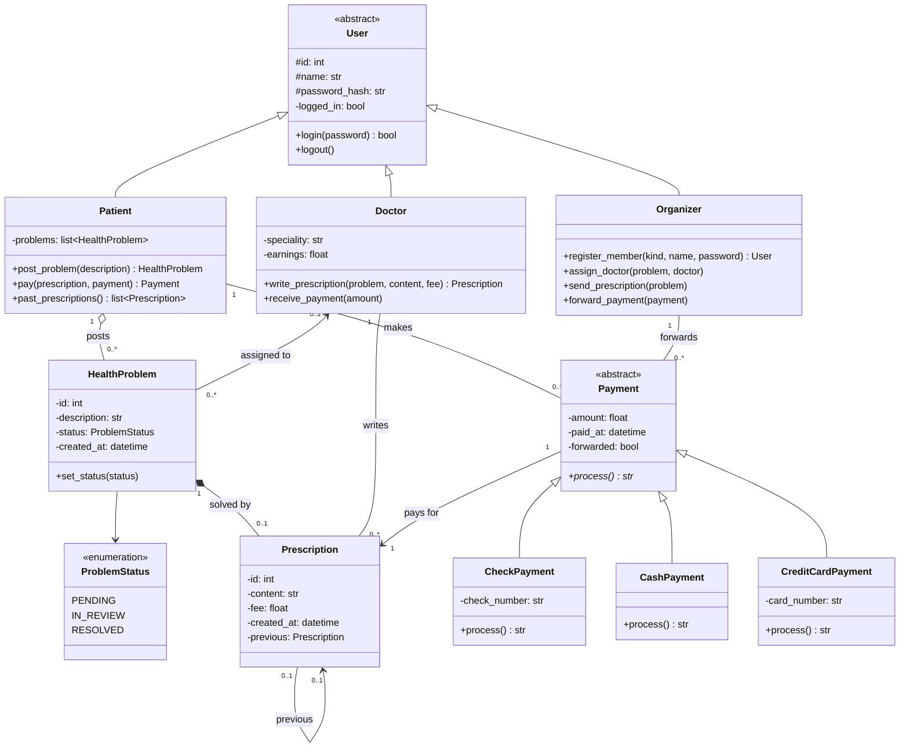
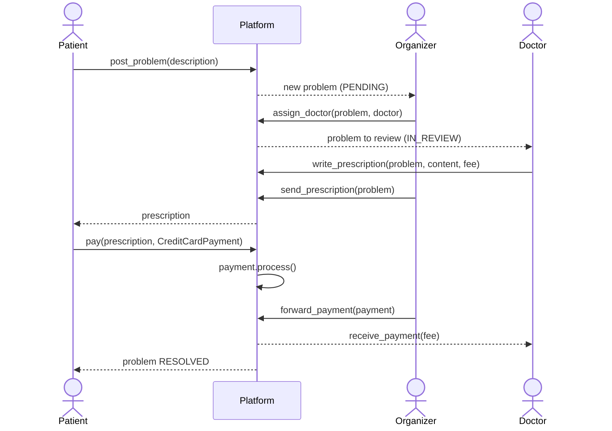
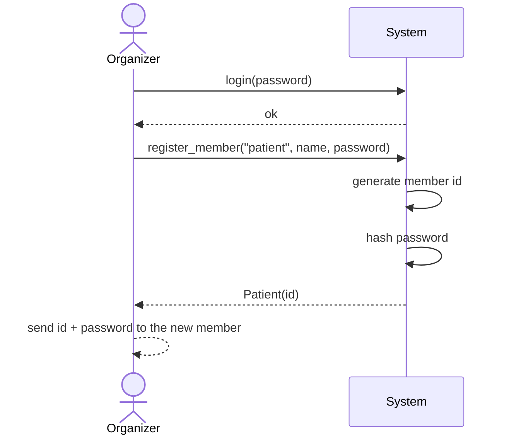
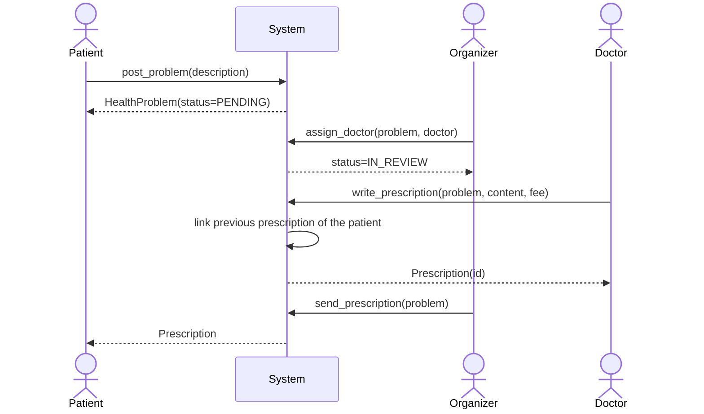
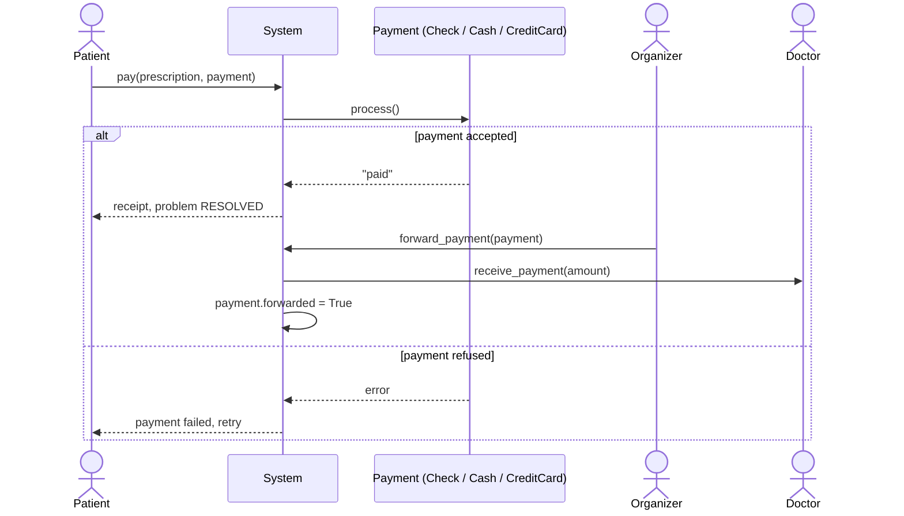

# Exo 1 - Hospital Management System 🏥

Énoncé : https://gist.github.com/bdallard/2d2407c4de4c182afca6d3ec7235e9eb (slide 68). Implémentation : [`hospital.py`](hospital.py).

## Task 1 : diagramme de classes de base

## Task 2 + 3 : diagramme de classes complet

Choix de modélisation :
- `User` est une **superclasse abstraite** (id, name, password, login/logout). `Patient`, `Doctor` et `Organizer` en héritent.
- `Payment` est **abstraite**, et le mode de paiement est modélisé par **polymorphisme** (pattern **Strategy**) : `CheckPayment`, `CashPayment` et `CreditCardPayment` redéfinissent `process()`.
- **Composition** `HealthProblem *-- Prescription` : une prescription n'existe pas sans le problème qu'elle résout.
- **Agrégation** `Patient o-- HealthProblem` : l'historique du patient regroupe ses problèmes.
- `ProblemStatus` est une énumération (PENDING, IN_REVIEW, RESOLVED) ; chaque objet a un timestamp.

## Task 2 : séquence « un patient soumet un problème, reçoit une prescription et paie »

## Task 3 : diagrammes de séquence système

### 1. Inscription d'un patient (l'Organizer crée un membre)

### 2. Consultation : de la soumission du problème à la livraison de la prescription

### 3. Paiement : le patient paie, l'Organizer reverse au Doctor

## Questions

1. **Un patient qui consulte plusieurs médecins ?** Chaque `HealthProblem` est assigné à un `Doctor` (0..1). Un patient qui a plusieurs problèmes peut donc avoir plusieurs médecins. Pour plusieurs médecins sur *un même* problème, on ajoute une classe d'association `Consultation` (problem, doctor, date, avis), avec une multiplicité `1..*` côté docteur.
2. **Des prescriptions réutilisables ?** Une prescription reste liée au problème qui l'a créée (composition), mais elle référence la précédente (`previous`) : on garde l'historique et un renouvellement crée une nouvelle prescription qui pointe vers l'ancienne. Pour de vraies prescriptions-types, on séparerait `PrescriptionTemplate` (réutilisable) et `Prescription` (instance datée pour un patient).
3. **Quel pattern pour le paiement ?** **Strategy** : chaque mode de paiement est une classe interchangeable qui implémente `process()`. On peut y ajouter une **Factory** pour créer la bonne stratégie à partir de `"check"`, `"cash"` ou `"card"`.
4. **Intégrité des paiements ?** Transactions atomiques en base (le paiement et le reversement réussissent ou échouent ensemble), clé d'idempotence pour ne pas payer deux fois, un flag `forwarded` qui empêche de reverser deux fois, un journal d'audit horodaté, et la validation du montant par rapport au `fee` de la prescription.
