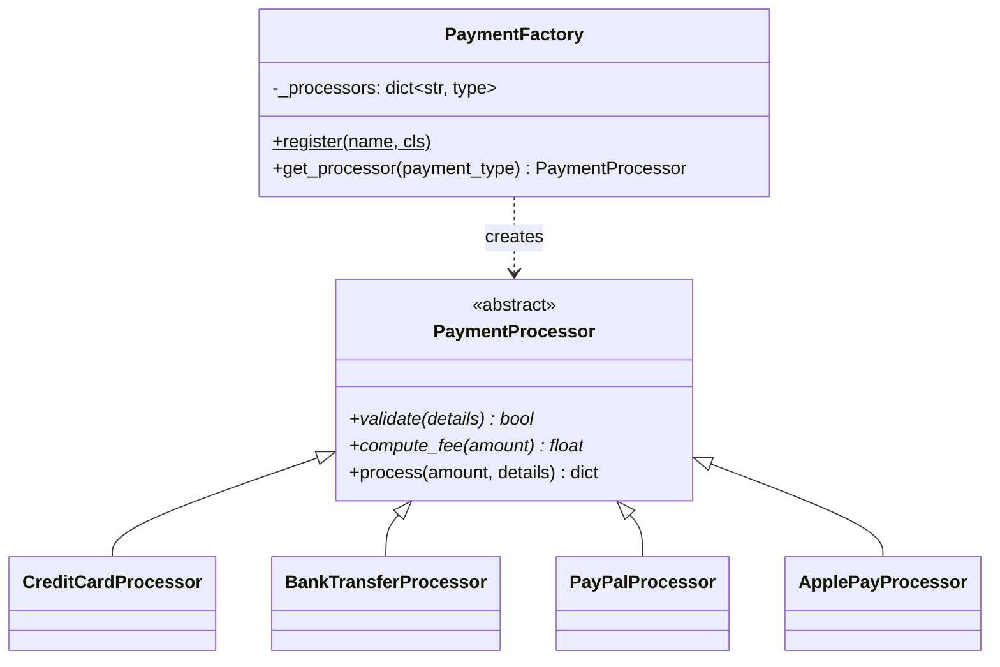
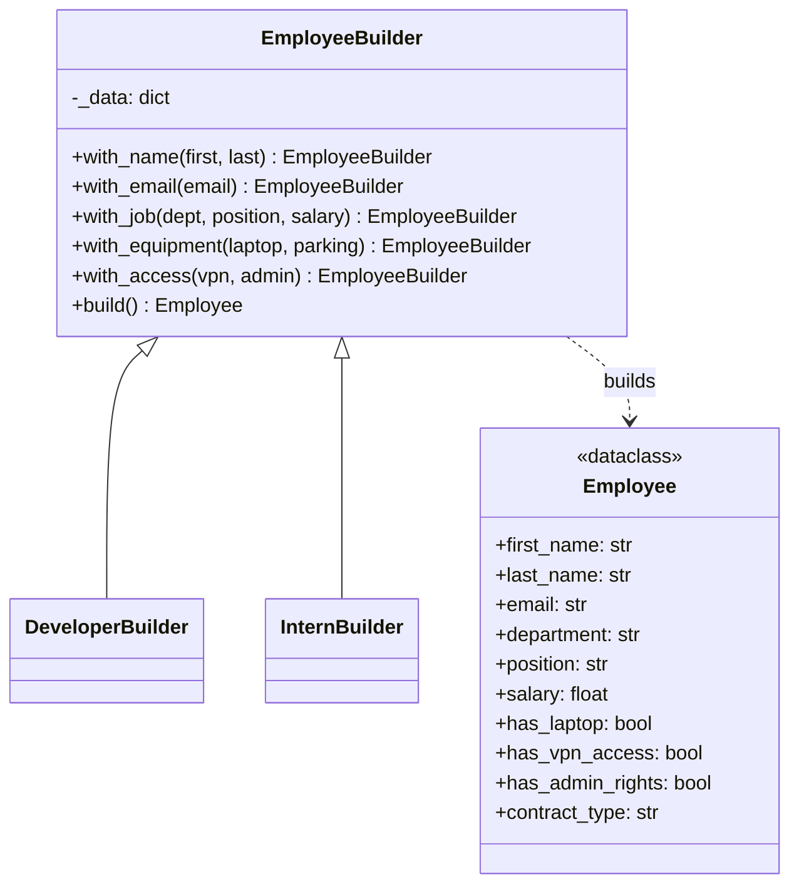
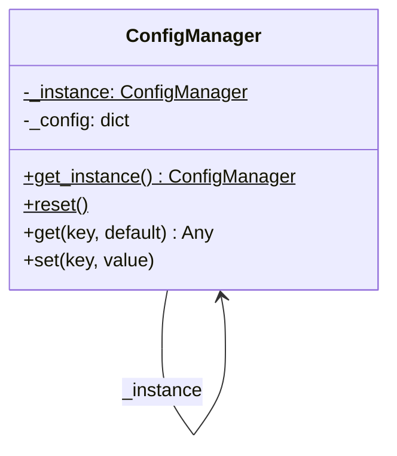
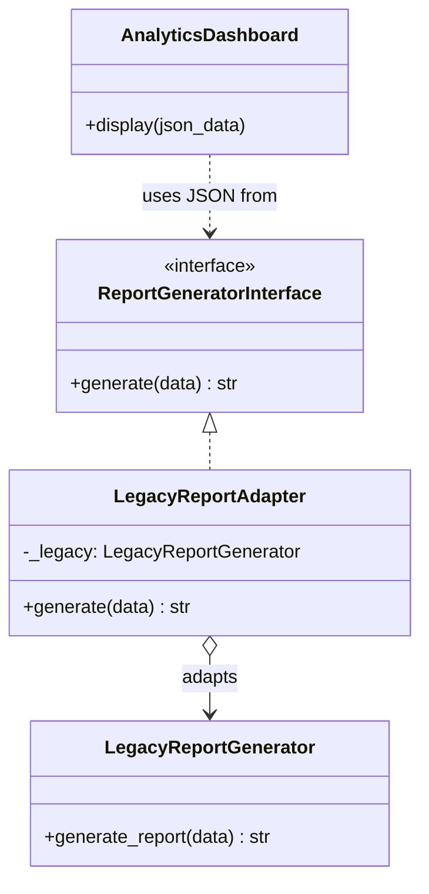
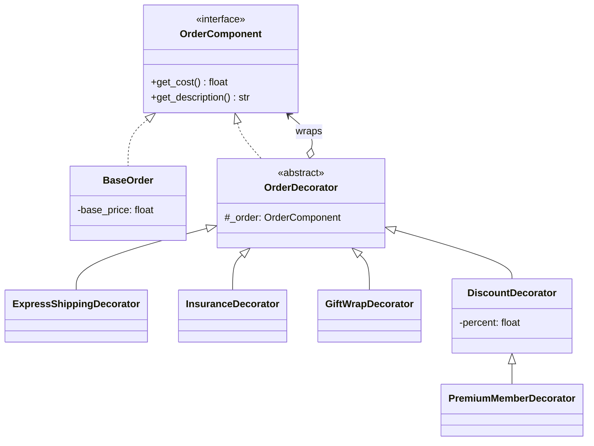
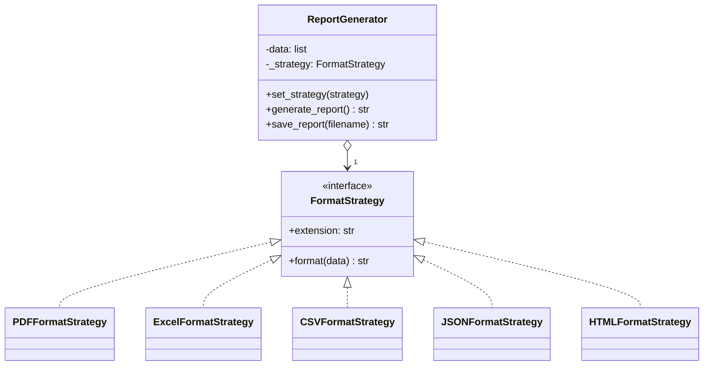
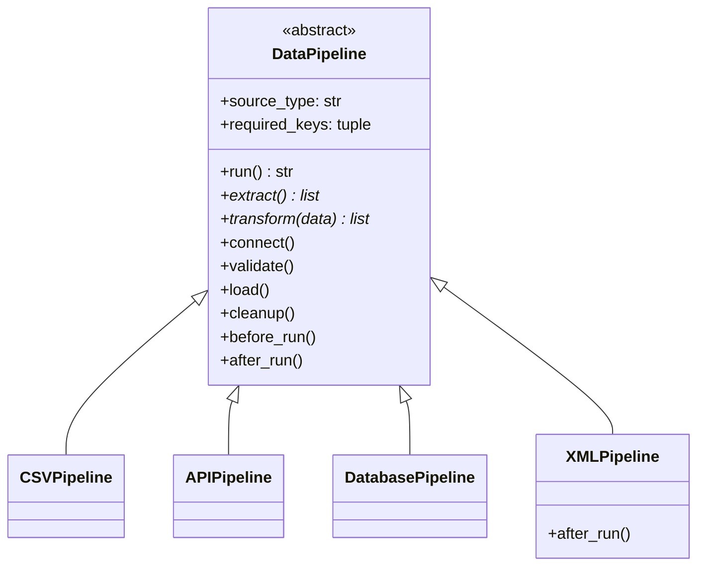

# 05 - Design patterns

Exercices du site du cours :
- [Creational patterns](https://courses.dallard.tech/sys_design/creational_pattern/)
- Structural patterns
- Behavioral patterns

Chaque fichier commence par la liste des problèmes du code « spaghetti » (step 1). Le code refactorisé suit, puis l'usage attendu dans `__main__`.

| Famille | Pattern | Exercice | Fichier |
|---|---|---|---|
| Créationnel | Factory | Payment system | [`creational/factory_payment.py`](creational/factory_payment.py) |
| Créationnel | Builder | HR Employee onboarding | [`creational/builder_employee.py`](creational/builder_employee.py) |
| Créationnel | Singleton | Configuration manager | [`creational/singleton_config.py`](creational/singleton_config.py) |
| Structurel | Adapter | XML → JSON reporting | [`structural/adapter_report.py`](structural/adapter_report.py) |
| Structurel | Decorator | Order pricing | [`structural/decorator_order.py`](structural/decorator_order.py) |
| Comportemental | Strategy | Multi-format reports | [`behavioral/strategy_report.py`](behavioral/strategy_report.py) |
| Comportemental | Template Method | ETL pipelines | [`behavioral/template_etl.py`](behavioral/template_etl.py) |

```bash
python3 creational/factory_payment.py      # etc.
python3 -m pytest                          # 13 tests
```

## Factory : système de paiement

**Problème :** une chaîne `if/elif` sur `payment_type`, qui viole Open/Closed. **Solution :** une classe par processeur, et une factory qui associe une chaîne à une classe grâce à un dictionnaire. `ApplePayProcessor` est ajouté avec `register()` sans modifier aucune classe existante.



## Builder : onboarding RH

**Problème :** un constructeur à 17 paramètres (telescoping constructor) et des booléens illisibles. **Solution :** des méthodes chaînables qui renvoient `self`, la validation regroupée dans `build()`, et des presets (`DeveloperBuilder`, `InternBuilder`).



## Singleton : gestionnaire de configuration

**Problème :** `config.json` est relu 4 fois, il n'y a pas d'état partagé et le code est difficile à mocker. **Solution :** `get_instance()` charge le fichier une seule fois. `get("database.host")` permet de lire les clés imbriquées, et `reset()` sert dans les tests.



## Adapter : rapports XML vers JSON

**Problème :** le générateur legacy (non modifiable) produit du XML, alors que le dashboard attend du JSON. **Solution :** `LegacyReportAdapter` implémente l'interface attendue et *enveloppe* le legacy (composition) pour convertir le XML en JSON.



## Decorator : calcul du prix d'une commande

**Problème :** 5 flags booléens dans une seule méthode, et un ordre des opérations implicite. **Solution :** chaque option est un décorateur qui enveloppe un `OrderComponent`. L'ordre d'empilement *est* l'ordre de calcul.



## Strategy : rapports multi-formats

**Problème :** deux chaînes `if/elif` (generate et save), on ne peut pas changer de format à l'exécution et le code est peu testable. **Solution :** une stratégie par format, et un contexte `ReportGenerator` avec `set_strategy()`. Le format HTML a été ajouté sans toucher au code existant, ce qui prouve que la conception est extensible.



## Template Method : pipelines ETL

**Problème :** connexion, validation, chargement et nettoyage sont copiés-collés dans 3 classes. **Solution :** `run()` (la *template method*) fixe le workflow une seule fois. Les sous-classes implémentent seulement `extract()` et `transform()`, et peuvent redéfinir les hooks `before_run()` et `after_run()`. Le pipeline XML valide la conception.


