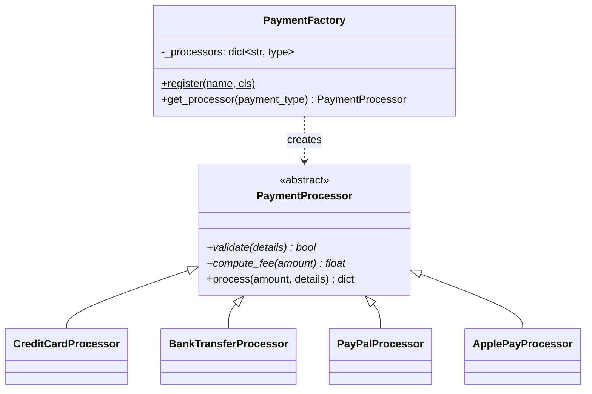
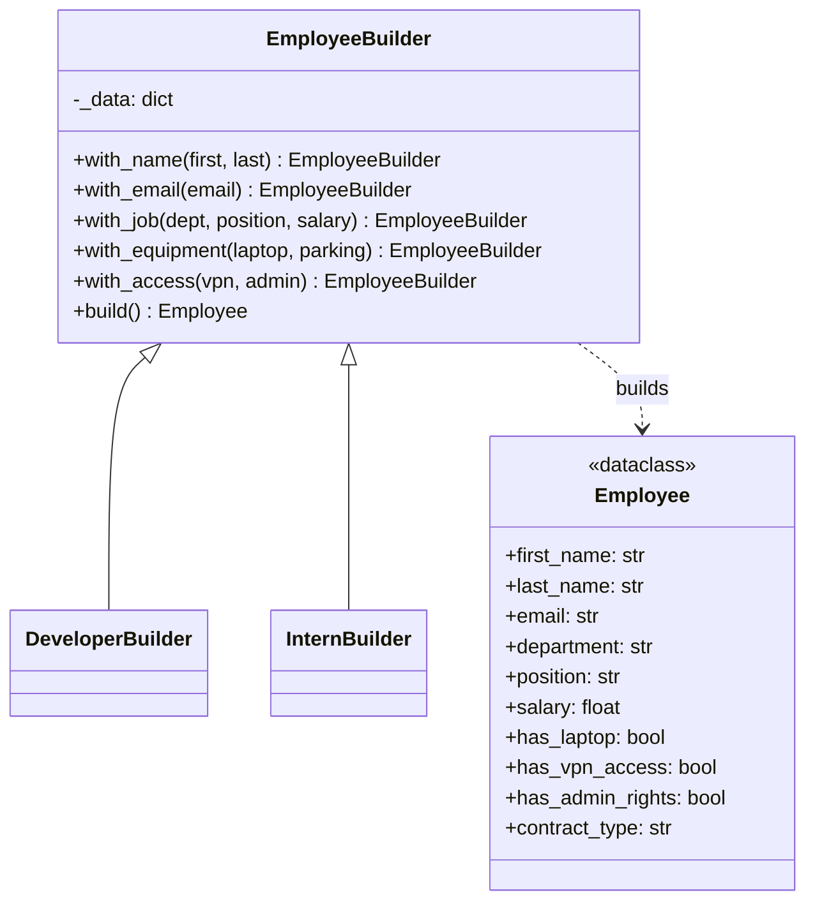
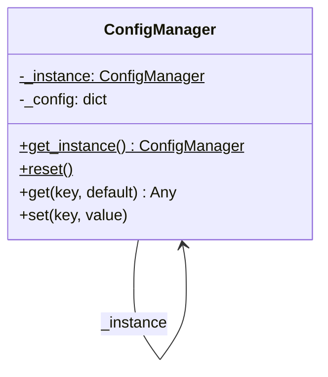
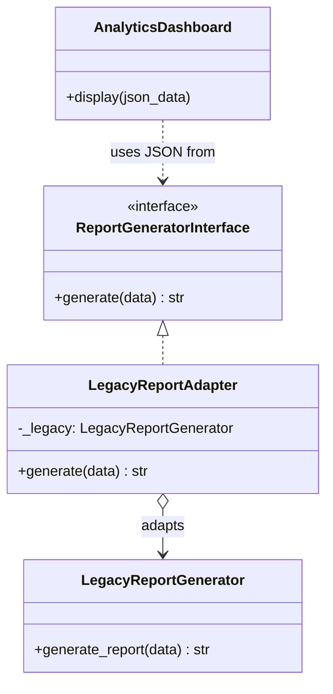
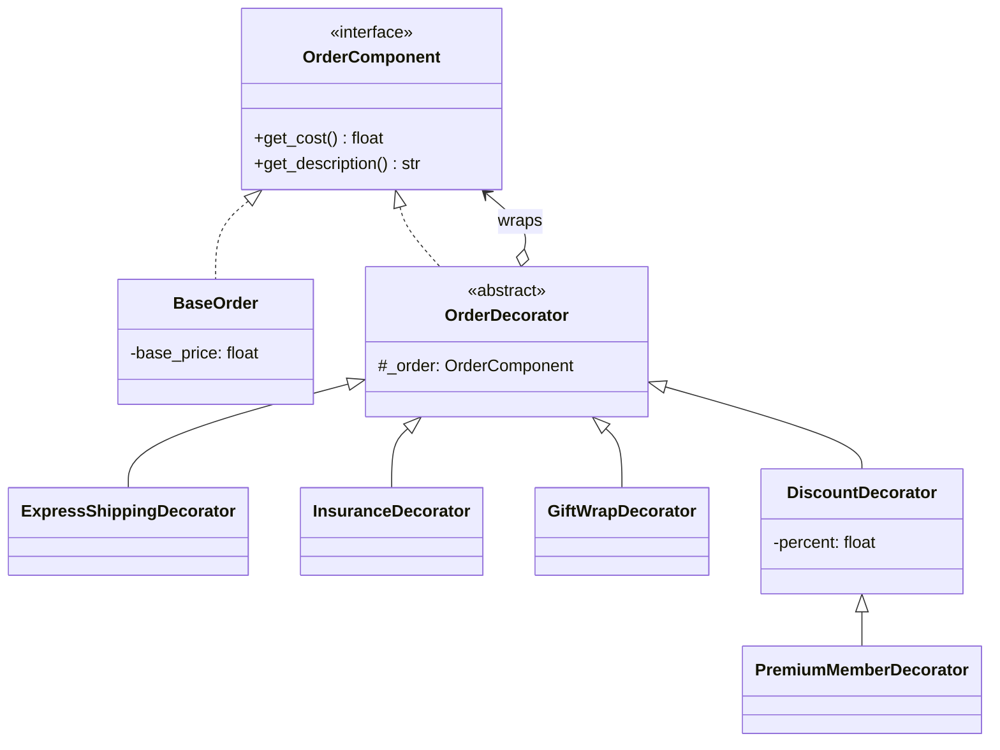
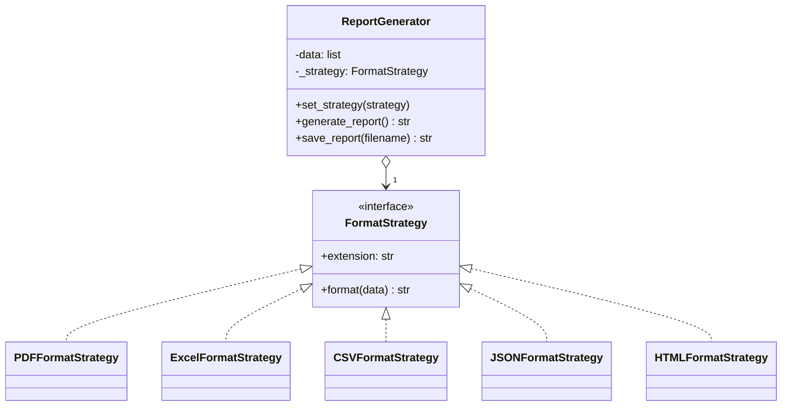
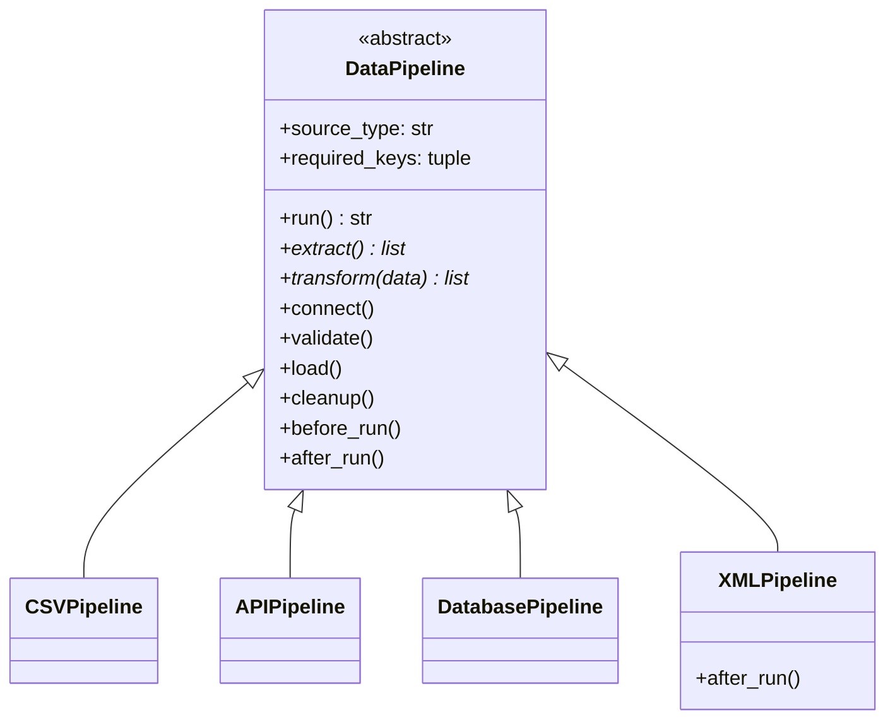

# 05 - Design patterns

Exercises from the course website:
- [Creational patterns](https://courses.dallard.tech/sys_design/creational_pattern/)
- Structural patterns
- Behavioral patterns

For each one I wrote the problems of the spaghetti code at the top of the file, then the refactored code, and the expected usage in `__main__`.

| Type | Pattern | Exercise | File |
|---|---|---|---|
| Creational | Factory | Payment system | [`creational/factory_payment.py`](creational/factory_payment.py) |
| Creational | Builder | HR employee onboarding | [`creational/builder_employee.py`](creational/builder_employee.py) |
| Creational | Singleton | Config manager | [`creational/singleton_config.py`](creational/singleton_config.py) |
| Structural | Adapter | XML -> JSON reports | [`structural/adapter_report.py`](structural/adapter_report.py) |
| Structural | Decorator | Order pricing | [`structural/decorator_order.py`](structural/decorator_order.py) |
| Behavioral | Strategy | Report formats | [`behavioral/strategy_report.py`](behavioral/strategy_report.py) |
| Behavioral | Template Method | ETL pipelines | [`behavioral/template_etl.py`](behavioral/template_etl.py) |

```bash
python3 creational/factory_payment.py
python3 -m pytest
```

## Factory - payment system

Problem: a big if/elif on `payment_type`, so adding a payment method means modifying the function (breaks Open/Closed). Solution: one class per processor and a factory with a dict that maps the string to the class. I added Apple Pay with `register()` without changing the other classes.



## Builder - HR onboarding

Problem: a function with 17 parameters and a lot of True/False that you can't read. Solution: chainable methods that return `self`, all the validation in `build()`, and presets (`DeveloperBuilder`, `InternBuilder`).



## Singleton - config manager

Problem: config.json is read 4 times and every module has its own copy. Solution: `get_instance()` loads the file only once, `get("database.host")` reads nested keys, and `reset()` is for the tests.



## Adapter - XML to JSON reports

Problem: the legacy generator (that we can't modify) returns XML but the dashboard wants JSON. Solution: `LegacyReportAdapter` implements the interface the dashboard expects, wraps the legacy object and converts XML to JSON.



## Decorator - order pricing

Problem: 5 boolean flags in one method and the order of the operations is not clear. Solution: each option is a decorator that wraps an `OrderComponent`, and the order you wrap them is the order of the calculation.



## Strategy - report formats

Problem: two if/elif chains (generate and save), you can't switch format at runtime and it's hard to test. Solution: one strategy class per format and a `ReportGenerator` with `set_strategy()`. I added HTML at the end without touching the other classes.



## Template Method - ETL pipelines

Problem: connect, validate, load and cleanup are copy-pasted in the 3 classes. Solution: `run()` is the template method that defines the steps once, subclasses only write `extract()` and `transform()` and can override the hooks `before_run()` / `after_run()`. I added the XML pipeline to check it works.


